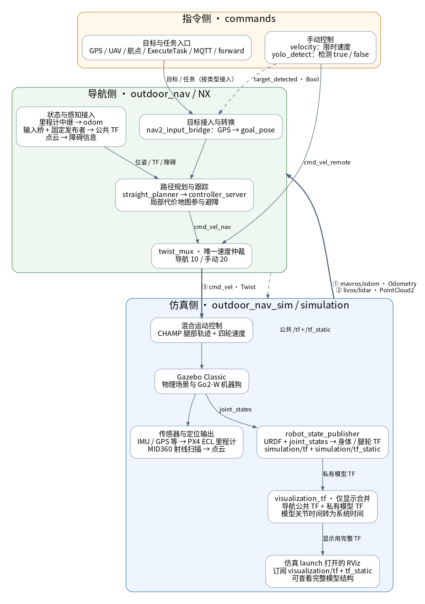
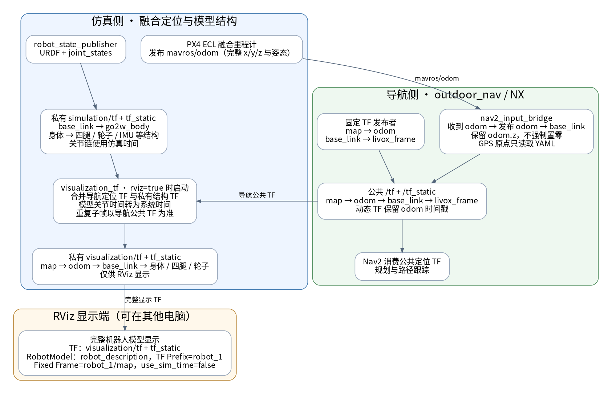
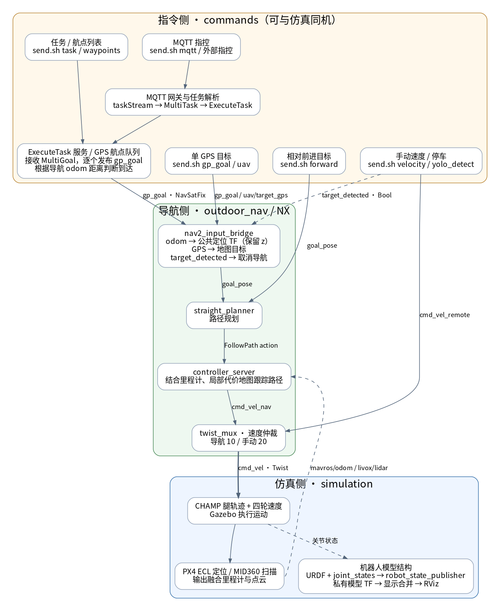

# 仿真侧目录

启动入口为 `bash simulation/start.sh`；公共参数放在 `config/`，ROS 源码放在 `src/`。

源码目录统一使用 `sim_<职责>`，上游第三方代码单独放在 `third_party/`。目录名用于说明职责，ROS 包名保留，现有包依赖、资源 URI 和启动命令继续有效。

| 源码目录 | 职责 | ROS 包名 |
| --- | --- | --- |
| src/sim_bringup | 环境启动编排、GPS/磁场/气压仿真生成 | simulation_bringup |
| src/sim_robot | Go2-W 模型、关节与混合运动控制 | go2w_sim |
| src/sim_world | 场景、地图、模型资源和接口辅助节点 | south_lake_sim |
| src/sim_lidar | MID360 扫描与点云生成 | mid360_simulation |
| src/sim_localization | PX4 ECL 定位融合与状态发布 | px4_gps_imu |
| src/third_party/champ | 第三方步态控制库及消息 | champ、champ_base、champ_msgs |

仿真环境编排放在 `src/sim_bringup/`，入口为 `simulation/start.sh`；导航由相邻 outdoor_nav 项目启动；目标与任务指令、MQTT 接入放在 `../commands/`。`src/sim_localization/vendor/` 是定位器固定版本的上游依赖，随定位包保留。

目录迁移后首次编译使用 `bash build_sim.sh --cmake-clean-cache`，刷新旧源码路径的 CMake 缓存。后续仍可直接 `bash build_sim.sh`。

本次迁移验证：8 个 ROS 包重新构建成功，5 项既有测试通过；安装目录无失效软链接，Classic 导航适配器已确认使用新的场景源码路径。

## Docker：Ubuntu 20.04 宿主机

### 环境与依赖范围

宿主机只需 Linux Docker Engine、当前用户的 Docker 访问权限、显卡驱动和 X11 桌面；不安装或加载宿主机 ROS/Gazebo。基础镜像是 `docker.io/osrf/ros:humble-desktop-full-jammy`，容器为 Ubuntu 22.04、ROS 2 Humble、Gazebo **Classic 11**。不安装 Fortress/Gazebo Sim 启动栈。Dockerfile 构建时执行 `gazebo --version`，版本不是 11 则构建失败。

扫描范围包括所有 9 个 `package.xml`、CMake、实际 launch、Classic world/model/xacro 插件及现有构建和 MQTT 安装脚本：

| 真实用途 | 镜像依赖处理 |
| --- | --- |
| Classic 世界、MID360、PX4 传感器插件 | gazebo、Jammy 的 libgazebo-dev（Classic 11 开发库）、gazebo_ros_pkgs、gazebo_plugins、Boost chrono |
| CHAMP 腿与四轮控制 | gazebo_ros2_control；rosdep 按 manifests 安装 velocity/position/diff_drive、joint_state_broadcaster、joint_trajectory_controller，CHAMP 源码已在本仓库 |
| 可视化与诊断 | RViz2、rqt、rqt_common_plugins、Mesa、xauth |
| ROS 网络 | Fast DDS 默认；安装 Cyclone DDS 供显式选择 |
| 标准 ROS、控制、Nav2、twist_mux 依赖 | 从 manifests 执行 rosdep 安装，包括 nav2_controller、nav2_lifecycle_manager、nav2_regulated_pure_pursuit_controller、twist_mux |
| 可选 MQTT 网关 | Paho C/C++、JSONCPP、yaml-cpp、OpenSSL、mosquitto、Python Paho/pymap3d/shapely；ROS 消息依赖通过 rosdep |

本仓库插件不直接依赖 PCL、pcl_ros、pcl_conversions 或 cv_bridge，因此不额外显式安装这些包；基础 desktop-full 或依赖链可能自带。没有为本仓库安装整套 navigation2/nav2_bringup：导航算法属于相邻 `outdoor_nav`，其中还有修改过的 Nav2 和自定义包，发行版二进制不能替代。镜像只复制依赖清单和容器脚本；源码、模型、ECL/Matrix 都从宿主机实时挂载。

### 构建镜像与进入容器

在宿主机普通用户的桌面终端执行：

```bash
cd /path/to/outdoor_nav_sim
./docker/build.sh
ROS_DOMAIN_ID=10 ./docker/run.sh
```

`build.sh` 使用仓库根目录作为构建上下文，传入当前用户 UID/GID，默认镜像名 `outdoor_nav_humble`。容器默认用户 `ros`，UID/GID 与宿主机一致，有容器内 sudo 权限；不要通过 `sudo ./docker/build.sh` 构建 root 用户镜像。切换宿主机用户后重新构建。可设置 `DOCKER_IMAGE` 同时覆盖 build/run 镜像名；构建参数可追加，例如 `./docker/build.sh --no-cache`。

`run.sh` 使用 `--network host`、`--shm-size 1g`，把当前仓库挂到 `/workspace`。默认域为 **10**，已有 `ROS_DOMAIN_ID` 优先，未改动本地启动脚本原有的域 30 默认值。容器进入时自动 source `/opt/ros/humble/setup.bash`、已存在的 `/workspace/install/setup.bash` 和项目 `ros_env.sh`。容器使用系统依赖，跳过仓库 `deps/` 中以前解包的 x86 二进制。

为隔离旧机器产物，`/workspace/{build,install,log}` 分别映射到宿主机 `.docker-workspace/{build,install,log}`，首次为空，保留宿主机原来的同名目录。源码修改立即可见；编译输出属于当前 UID，退出容器后仍保留。可通过 `DOCKER_ARTIFACT_DIR=/absolute/path` 为另一镜像选择新的产物目录；更换 ROS/架构时应换目录或清理。

若 `docker` 实际是 rootless Podman，`run.sh` 自动添加 `--userns=keep-id`。仅镜像内外数字 UID 相同还不够：Podman 默认把宿主机用户映射为容器 root，导致普通用户 `ros` 看见挂载目录属于 `0:0` 而无法写入。脚本在进入容器前会以实际用户和挂载配置测试 build/install/log 写入。出现 `PermissionError: log/build_...` 时，先在宿主机同步新版脚本，退出旧容器并重新执行 `./docker/run.sh`；无需重建镜像或更改目录权限。旧容器的用户映射不能通过 `source` 或 `docker exec` 改变。如果仍失败，检查宿主机 `.docker-workspace` 的实际归属和只读挂载，再针对该产物目录修复权限，不要对整个仓库执行 `chmod 777` 或递归改成容器的 subordinate UID。

### rosdep、重新编译与启动

仓库不是根目录 `src/` 结构。镜像已初始化 rosdep 并根据 `simulation/src commands/src` 安装依赖；源码依赖变更后可在容器中重新执行：

```bash
cd /workspace
source ros_env.sh
rosdep update --rosdistro humble
sudo apt-get update
rosdep install --from-paths simulation/src commands/src --ignore-src -r -y \
  --rosdistro humble \
  --skip-keys "$(tr '\n' ' ' < /usr/local/share/outdoor-nav/rosdep-skip-keys.txt)"
```

skip 文件仅列出相邻 `outdoor_nav` 提供的六个自定义包：`nav2_input_bridge`、`nav2_straight_planner`、`msg_set_msgs`、`multi_task_bridge`、`execute_task_server`、`multi_goal_to_gp_goal`。跳过只是避免 rosdep 查询不存在的公共安装规则，不代表这些包已安装。仿真默认 `navigation:=false` 可独立构建启动；MQTT 和任务链仍需这些源码包。

首次编译无需清理，因为容器输出目录全新。容器内的 build/install/log 是挂载点，不能用 `rm -rf build install log` 删除挂载点本身；需要全量重编译时，先退出所有使用这些产物的容器，再在**宿主机**执行：

```bash
rm -rf .docker-workspace/build .docker-workspace/install .docker-workspace/log
ROS_DOMAIN_ID=10 ./docker/run.sh
```

这与删除容器工作区的 build/install/log 后重新构建效果相同，不会加载旧 Ubuntu 22.04 工作区的产物。在容器中执行实际编译命令：

```bash
cd /workspace
colcon build --base-paths simulation/src --executor sequential --symlink-install \
  --cmake-args -DCMAKE_BUILD_TYPE=Release -DBUILD_TESTING=ON
source install/setup.bash

# 运行项目原有构建和测试流程（已编译的包增量处理）
bash build_sim.sh

# 核对 Classic 和实际启动参数
gazebo --version
ros2 launch simulation_bringup go2_px4_sim.launch.py --show-args

# 真实仿真入口：农田 / Go2-W / CHAMP / PX4 ECL / MID360 / ZNY
bash simulation/start.sh
# 无桌面时用：bash simulation/start.sh gui:=false rviz:=false
```

不要在根目录裸跑 `colcon build`：它还会找到可选 MQTT 网关，网关需要本仓库以外的消息与后端源码。默认仿真仅需 `simulation/src` 中的 8 个包。`build_sim.sh` 运行既有测试，其中生命周期测试使用独立 domain 81；运行测试前确保没有实际机器人使用该域。

### Gazebo、RViz、rqt 与 GPU

在宿主机桌面终端进入容器，脚本传入 `DISPLAY`、挂载 `/tmp/.X11-unix`、设置 `QT_X11_NO_MITSHM=1`，优先挂载当前 Xauthority cookie。没有 cookie 时使用仅限当前 UID 的 `xhost +si:localuser:<用户名>`，退出时撤销本脚本新增的授权；不会运行开放全部访问的 `xhost +`。并发 GUI 容器建议使用 Xauthority，避免一个终端退出时撤销另一个终端依赖的临时授权。当前实现面向本机 X11/Xwayland，不自动配置 SSH X11 转发。

仿真入口默认打开 gzclient 和 RViz。另开宿主机终端，使用同一域进入第二个容器即可运行 GUI 工具（第二个终端不要同时启动另一套 gzserver）：

```bash
ROS_DOMAIN_ID=10 ./docker/run.sh
# 容器中分别按需执行
gzclient
rqt
# 项目显示 TF 的 RViz 配置说明见下文“定位 TF、模型结构 TF 与 RViz”
rviz2
```

`gazebo` 命令也可独立显示 GUI，但它会启动新的 server，应在没有运行项目 gzserver 时使用。容器的 Gazebo model/plugin/resource 路径先清空再由容器 Classic、ROS、workspace 及 launch 设置；不导入宿主机路径，也不挂载宿主机 `/opt/ros`、Gazebo 库或整个 `/usr`。Classic 自带的 `ignition-*` 底层库属于它的依赖，不表示使用了 Gazebo Sim。世界文件使用的 `cpr_agriculture`、`DepotCollision` 和机器人/雷达资源均在仓库中。

由于 host network 共享端口，容器 Classic 默认使用 `http://127.0.0.1:11346`，避开宿主机 Classic 默认的 11345。若 11346 已被其他实例占用，在所有相关终端一致设置 `DOCKER_GAZEBO_MASTER_URI=http://127.0.0.1:11347`；不要让两个 gzserver 共用 master 端口。该设置独立于宿主机的 `GAZEBO_MASTER_URI`。

GPU 自动模式先检查宿主机 `nvidia-smi`，再用实际 `docker run --gpus all ... nvidia-smi -L` 验证 Toolkit 能否工作。通过后加入 `--gpus all` 和 `graphics,utility,compute,display` 驱动能力；失败则普通运行。有 `/dev/dri` 时映射设备，并加入其数字设备组以供普通用户访问。没有 GPU 也能进入容器，可使用 Mesa 软件渲染：

```bash
DOCKER_GPU=0 LIBGL_ALWAYS_SOFTWARE=1 ./docker/run.sh
DOCKER_GUI=0 ./docker/run.sh bash -c 'bash simulation/start.sh gui:=false rviz:=false'
# 强制要求 NVIDIA，探测失败则明确报错：
DOCKER_GPU=1 ./docker/run.sh
```

`DOCKER_GUI=1` 强制要求 X11，默认 `auto` 在没有 DISPLAY 时进入无 GUI 模式。NVIDIA Container Toolkit 必须由宿主机管理员配置；本仓库不修改宿主机 ROS/Gazebo 或驱动配置。软件渲染的仿真实时率取决于宿主机性能。

### 与 Jetson Orin NX 的 DDS 通信

容器 host network 直接使用宿主机网卡；NX 与容器需可互通、域和机器人命名空间一致。默认 Fast DDS 使用仓库 `simulation/config/fastdds_udp.xml`，显式禁用 SHM，避免 host network 下发现成功但跨 IPC 命名空间收不到消息。自定义 RMW/DDS 配置优先保留；可显式设 `RMW_IMPLEMENTATION=rmw_cyclonedds_cpp`，并配置适用的 Cyclone URI。

仿真电脑：`ROS_DOMAIN_ID=10 ./docker/run.sh`，容器内 `bash simulation/start.sh`。NX 上使用其已经编译的 **ARM64** outdoor_nav 工作区（仿真容器不挂载 NX 或宿主机旧 install）：

```bash
cd /path/to/outdoor_nav
ROS_DOMAIN_ID=10 bash deploy/nx/run.sh hil
```

两端同步 `simulation/config/nav.yaml` 的 GPS 原点、命名空间和 ZNY 外参，导航使用系统时间。等待 PX4 EKF `ready=1`、导航 active 和新鲜 TF，再下达任务。进入容器后可检查实际消息，命名空间非默认时替换 `robot_1`：

```bash
source ros_env.sh
ros2 topic list --no-daemon --spin-time 5
timeout 12 ros2 topic echo /robot_1/mavros/odom nav_msgs/msg/Odometry \
  --once --field header --qos-reliability best_effort
timeout 12 ros2 topic echo /robot_1/livox/lidar sensor_msgs/msg/PointCloud2 \
  --once --field header --qos-reliability best_effort
ros2 lifecycle get /robot_1/controller_server
timeout 6 ros2 run tf2_ros tf2_echo robot_1/map robot_1/base_link
```

仅发现 topic 不代表通信成功。多网卡/VPN、宿主机或 NX 防火墙、Wi-Fi AP 禁止组播均需按真实网络排查，允许双方 DDS UDP 流量。不要设 `ROS_LOCALHOST_ONLY=1`。脚本传入已有的 `ROS_LOCALHOST_ONLY`、`ROS_DISCOVERY_SERVER`、`CYCLONEDDS_URI`、`FASTRTPS_DEFAULT_PROFILES_FILE`、`FASTDDS_DEFAULT_PROFILES_FILE`；仓库内的绝对路径自动转换为 `/workspace` 路径（含 `file://` URI），其他文件路径必须在容器中可读。自定义配置可放在源码挂载目录中，或通过以下只读挂载：

```bash
DOCKER_DDS_DIR="$HOME/dds" \
FASTRTPS_DEFAULT_PROFILES_FILE=/dds/fastdds.xml \
FASTDDS_DEFAULT_PROFILES_FILE=/dds/fastdds.xml \
ROS_DOMAIN_ID=10 ./docker/run.sh
```

### 外部依赖与验证边界

`outdoor_nav` 的自定义导航、任务消息、服务和 `swarms_backend` 源码不属于本仓库，镜像不下载、复制或修改相邻工作区。完整导航在 NX 运行；可选 MQTT 网关需要另行挂载该源码并在 Jammy/Humble 容器内重编译相关包，然后按 `commands/README.md` 构建网关（CMake 设置 `OUTDOOR_NAV_SOURCE`）。不要复用以前机器的 install 或 x86 产物到 NX。容器已经安装 MQTT 原生库，不必再运行向 `deps/mqtt` 解包系统二进制的旧安装步骤。

拉取基础镜像、APT 和 rosdep 需要网络；宿主机 Docker 权限、NVIDIA Toolkit、显示认证和 NX 防火墙不能在镜像内自动解决。

2026-10-26 交付验证：当前验证机为 Ubuntu 22.04，`docker` 实际是 Podman 3.4.4 兼容 CLI，使用 `./docker/build.sh --format docker` 成功构建最终镜像（真正 Docker Engine 使用前述普通构建命令）。断网容器中确认用户 `ros` 的 UID/GID 为 1000，Classic 版本为 11.10.2，GUI 工具命令、标准 Nav2/控制器/DDS 包和 MQTT Python 导入正常。源码只读挂载，使用 `/tmp` 全新输出目录编译 8 个仿真包成功，`px4_fusion`、`hybrid_command` 两项既有测试通过，实际 `go2_px4_sim.launch.py --show-args` 加载成功。上游 ECL/Matrix 编译出现 GCC `-Wstringop-overflow` 警告，未修改上游文件，融合测试通过。当前 rootless Podman 验证使用 `--userns=keep-id` 保持绑定目录 UID；交付的运行脚本面向 Linux Docker Engine。

运行脚本另通过模拟 Docker 命令检查了 GPU 探测成功/失败降级、无桌面、自定义域与 DDS、带空格路径，以及 X11 cookie 与 xhost 授权清理。尚未在 Ubuntu 20.04 Docker Engine、真实 GUI/NVIDIA 渲染和 Jetson NX 跨机 DDS 上实机验收；工具命令存在与启动参数加载不代表窗口和跨机数据已经验收。


## 当前运行流程

1. `build_sim.sh` 构建 8 个 ROS 包并运行融合、混合控制、生命周期、启动配置与接口契约测试。可选 MQTT 网关由 `commands/setup_mqtt.sh` 构建。
2. `simulation/start.sh` 加载 ROS/DDS 环境、共享导航参数、ZNY 生成位置与传感器参数，直接启动 `simulation_bringup/go2_px4_sim.launch.py`。
3. 环境启动 Gazebo Classic 并暂停物理，加载场景与 Go2-W 模型，按顺序配置关节状态、腿部轨迹与轮速控制器。控制器就绪后解除暂停，再启动 PX4 ECL 定位。
4. 物理模型产生原生 IMU；GPS/地速/磁场/气压插件产生带噪测量；PX4 ECL 融合后发布 `/robot_1/mavros/odom`。MID360 射线插件根据 CSV 扫描模式发布 `/robot_1/livox/lidar`。真值只用于测量生成与验证，不输入定位或导航。
5. 导航在相邻 `outdoor_nav` 项目启动（NX 为 `deploy/nx/run.sh hil`）；同机可用 `outdoor_nav/launch_hil.sh`。ZNY 接法由导航发布公共 TF，负责输入转发与速度仲裁，仿真模型 TF 保持在私有话题。
6. `commands/send.sh` 下发 GPS/UAV/航点/任务；`commands/start.sh` 提供任务服务或 MQTT 接入。导航输出 `cmd_vel`，混合控制器分配给 CHAMP 腿轨迹与四轮速度，Gazebo 执行后反馈新的传感器数据。

### 当前 ZNY 模式整体链路

橙色大框为指令侧，绿色大框为导航侧，蓝色大框为仿真侧；按指令 → 导航 → 仿真从上到下排列。框内为本侧模块，跨框箭头标注接口。图中 topic 省略默认 `/robot_1/` 前缀。




[可编辑图源](diagrams/navigation_overview.dot)


状态接入中的 mavros_odom_relay 与 nav2_input_bridge 都订阅 mavros/odom：中继发布 odom，导航输入桥根据同一里程计生成 odom→base_link TF，保留 odom.z；GPS 目标转换也是同一个 nav2_input_bridge 的另一项功能。map→odom 与 base_link→livox_frame 是导航侧固定 TF。点云进入导航后用于规划器避障与控制器局部代价地图；控制器根据路径、里程计和障碍计算速度。

| 跨侧方向 | 默认话题 | 内容与约定 |
| --- | --- | --- |
| 仿真 → 导航 | /robot_1/mavros/odom | Odometry，BEST_EFFORT，系统时间戳；由 PX4 ECL 融合产生 |
| 仿真 → 导航 | /robot_1/livox/lidar | PointCloud2，BEST_EFFORT，系统时间戳，xyz FLOAT32 |
| 导航 → 仿真 | /robot_1/cmd_vel | Twist，本体系 vx/vy/wz；仿真 0.5 秒墙钟无新指令即停车 |
| 导航内部 / 导航 → 仿真显示 | /tf、/tf_static | 导航发布定位 TF 与雷达固定外参；帧名带机器人命名空间 |

仿真内部的 /clock 继续驱动 Gazebo、CHAMP 和定位融合；默认 ZNY 导航使用系统时间，不依赖仿真 /clock。公共 TF 由导航负责，仿真模型 TF 仅用于私有调试。仿真真值只参与传感器生成和测试，不作为导航定位输入。

### 定位 TF、模型结构 TF 与 RViz



[可编辑图源](diagrams/navigation_tf.dot)

公共 `/tf`、`/tf_static` 由导航发布，只包含定位与雷达安装链。身体、腿轮等结构由 `robot_state_publisher` 发布到私有 `/{ns}/simulation/tf{,_static}`，不会直接出现在普通 RViz 订阅的公共 TF 中。`visualization_tf` 在 `rviz:=true` 时合并两类 TF 到 `/{ns}/visualization/tf{,_static}`，仿真 launch 打开的 RViz 已配置使用这组话题。该合并只用于显示，不参与导航定位。

手动打开另一份 RViz 时，需要订阅显示用 TF（以下使用默认命名空间）：

```bash
source ros_env.sh
rviz2 --ros-args -p use_sim_time:=false \
  -r /tf:=/robot_1/visualization/tf \
  -r /tf_static:=/robot_1/visualization/tf_static
```

在 RViz 添加 RobotModel，描述话题选 `/robot_description`（Durability 设为 Transient Local）、TF Prefix 填 `robot_1`，Fixed Frame 选 `robot_1/map`。若要看坐标轴和 TF 树，勾选 TF 显示项；项目配置默认关闭该项以减少坐标轴遮挡，RobotModel 默认开启。自定义命名空间时同步替换上述前缀。若使用 `rviz:=false` 启动仿真，显示合并节点也不会启动，需要重启仿真并启用 RViz。

实际检查：domain 30 下公共链可以查询 `map → base_link`，显示用链可以查询 `map → FL_foot`；公共链查不到腿轮结构符合当前设计。

### 指令接入到运动执行的详细链路




[可编辑图源](diagrams/navigation_commands.dot)


ExecuteTask 的 success 与 MQTT ACK 表示相应层已接收请求；最终是否到达需看导航动作和实际位置。航点队列通过 odom 判断到达并推进下一个 GPS 目标。commands 可以运行在仿真电脑或另一台已配置 ROS 的电脑上，颜色按职责区分，不表示必须部署在三台机器。手动速度走 cmd_vel_remote；yolo_detect 命令实际发布原有 target_detected 接口，请求停止规划并取消跟踪；--clear 仅发送 false，不恢复导航，不提供速度锁。图像已实际渲染检查，Graphviz 图源与 PNG 同目录。修改 `.dot` 后使用 `dot -Tpng -Gdpi=120 图源.dot -o 预览.png` 刷新。航点队列属于 commands 启动的任务接入层，按职责放在指令侧框内；单目标不会进入航点队列。


日常运行：

```bash
bash simulation/start.sh
bash ../outdoor_nav/launch_hil.sh params_file:="$PWD/simulation/config/nav.yaml"
bash commands/send.sh gp_goal --dry-run
```

前两条在不同终端运行；两侧 ROS 域、命名空间和 GPS 原点一致。实际目标参数见 [指令与任务交接](../commands/README.md)。

## 每个目录的保留依据

| 目录 | 保留内容与使用位置 |
| --- | --- |
| simulation/config | 默认 ZNY 启动、共享导航参数和 Fast DDS UDP 配置 |
| sim_bringup | 环境/兼容导航 launch、传感器插件、启动辅助脚本、启动及接口测试 |
| sim_robot | 当前 xacro 引用的网格，hybrid/wheels 分支参数，控制与模拟键盘、运动测试 |
| sim_world | agriculture 默认场景、depot 可选场景、empty 集成测试场景及其完整引用资源；RViz 和兼容配置 |
| sim_lidar | 射线插件源码/头文件、实际读取的扫描 CSV |
| sim_localization | 定位节点、融合封装、编译所需 ECL/Matrix 子集、磁场表与融合测试 |
| third_party/champ | 唯一步态控制节点、其传递头文件和消息依赖，以及许可证/来源 |

保留现有测试覆盖的 Classic、depot 和 wheels 分支。它们有可达启动路径；不以“默认没有启动”判定无用。所有许可证、来源记录和当前仿真说明保留。

## 清理结果

逐项检查 `simulation/` 下原有 389 个文件，删除 148 个（含 5 个生成缓存及后续移除的导航包装），保留 241 个原有文件。移除约 11.75 MiB：

- 无入口引用的旧 FAST-LIO、旧机器人控制、步态与 Nav2 配置。
- 旧底盘网格、未使用的脚掌和 Livox 外壳、3 张没有模型/材质引用的纹理。
- 未启动的 CHAMP 硬件转发、替代状态估计节点、硬件占位代码及其配置和无使用者的消息定义；对应编译/安装目标同步移除。
- ECL 上游 MATLAB 日志回放、符号推导和开发 PDF、未执行的子 CMake 与地磁表生成脚本，以及两个无编译依赖的 Matrix 可选工具头文件。
- 仅转发启动的 `go2w_px4_sim.launch.py`；调用方改为直接启动 `go2_px4_sim.launch.py`。

每一个原文件的处理结果及理由见 [FILE_AUDIT.tsv](FILE_AUDIT.tsv)。删除内容及旧的逐包构建/安装产物暂存于 `/tmp/outdoor_nav_sim_file_audit_20261021`；项目安装产物已从清理后的源码重新生成，防止旧安装资源掩盖问题。

## 验证

- 8 个包从干净的逐包构建/安装目录构建成功，5 项既有测试通过。
- 检查 174 处模型、网格、图片、材质引用，无缺失，见 `tests/results/simulation_asset_check.json`。
- 实际 ZNY 仿真与导航联调结果见 `tests/results/simulation_cleanup_live.json`；使用独立通信域及 Gazebo master，不下发运动目标。

实测定位约 72.3 Hz、点云约 9.4 Hz，导航 active、公共 TF 发布者归属和 ZNY 时间戳/QoS/字段均通过，测试实例已停止。停止过程中导航侧 `straight_planner` 退出码为 -11（段错误），运行阶段的检查已通过；此问题尚未定位，记录为单独的导航退出缺陷，本次未改导航源码。清理后保留文件与逐文件清单完全一致，安装目录无失效软链接，已删除组件未残留在安装目录。

## 导航对接接口

两侧 ROS_DOMAIN_ID、命名空间、GPS 参考原点与时间基准必须一致；跨机需同步系统时钟并允许 DDS 通信。
自定义 params_file 时两端使用相同内容。默认原点与 outdoor_nav 的 zny_hil.yaml 一致。

| 方向 | 默认接口 | 契约 |
| --- | --- | --- |
| 仿真 → 导航 | /robot_1/mavros/odom | Odometry，BEST_EFFORT，系统时间戳，ENU 位姿、本体 twist，≥30 Hz 需实测 |
| 仿真 → 导航 | /robot_1/livox/lidar | PointCloud2，BEST_EFFORT，xyz FLOAT32，point_step=12，约 10 Hz 墙钟 |
| 导航 → 仿真 | /robot_1/cmd_vel | Twist，RELIABLE 订阅，本体系速度，0.5 秒墙钟超时停车 |

导航负责 map→odom、odom→base_link、base_link→livox_frame；仿真 ZNY 不发布这些变换。仿真模型 TF 发布到
/robot_1/simulation/tf 和 tf_static，调试用途；不进入公共 /tf。雷达实际安装相对导航 base_link
为 (0.18,0,0.53)m、前倾 18°，与导航公共固定 TF 一致。

Gazebo 内部仍发布 /clock，供仿真控制器和传感器融合使用；ZNY 导航不依赖它。
public odom 与点云在实际输出时使用系统时间；内部 EKF 测量时间与原始估计保持仿真时间。
原始 EKF odom 位于 simulation/ekf_odom，真值位于 simulation/truth/odom；真值不输入导航。

NX 只部署 outdoor_nav 即可，不再需要仿真适配源码、Gazebo 或仿真动态库。
等待 EKF ready=1、导航生命周期 active、收到新鲜 TF 后，再使用 commands/send.sh 下发目标。

NX/导航端在 `outdoor_nav` 目录运行 `bash deploy/nx/run.sh hil`，同机快捷入口为 `bash ../outdoor_nav/launch_hil.sh params_file:="$PWD/simulation/config/nav.yaml"`。接口实现与历史联调数据见 [启动包说明](src/sim_bringup/README.md#zny-接口实现与验证)。

## 入口与公共环境收敛

根目录的两个 launch_hil 转发脚本、ros2.sh 及 simulation/navigation.sh 已删除。根 ros_env.sh 现在直接承担全部环境初始化，commands/env.sh 已合并删除。ROS 命令先 source 环境再直接执行；导航直接使用导航项目的 launch_hil.sh。需要相同参数时显式传入 simulation/config/nav.yaml。


剩余 Shell 入口各有实际职责：build_sim.sh 构建并测试；simulation/start.sh 选择协议与参数并启动环境；commands/send.sh 分派下发；commands/start.sh 管理任务/MQTT 模式；commands/setup_mqtt.sh 准备可选依赖；ros_env.sh 统一初始化环境。节点实现、输入校验、目标计算、进程管理与隔离测试脚本保留，不再新增纯转发包装。

### 脚本复核结果

本次逐项复核项目维护的 6 个 Shell 和 32 个 Python 文件；第三方依赖包自带脚本及构建生成文件不作为项目入口维护。

| 保留的 Python 范围 | 数量 | 实际职责 |
| --- | --- | --- |
| commands/scripts | 8 | 输入生成与校验、目标计算和发布、服务复用、MQTT ACK 与子进程管理 |
| commands/src/outdoor_nav_mqtt_sim | 2 | MQTT 任务管线编排、禁用模拟 FCU 状态的任务桥 |
| sim_robot/scripts | 4 | 控制器激活、混合驱动、固定腿初始化、交互键盘控制 |
| sim_world/scripts | 2 | Classic 完整融合 TF、遥控取消导航 |
| sim_bringup/launch | 1 | 仿真环境编排和 RViz 启动；导航由 outdoor_nav 启动 |
| sim_bringup/scripts | 2 | 有界生命周期 RPC 与启动看门狗 |
| 包内及 tests/integration 测试 | 10 | 定位/控制/接口/启动与隔离仿真验证 |

复核后不存在项目自有的纯命令转发脚本。6 个 Shell 入口按上节职责保留，不为同一命令维护别名包装。构建与 5 项测试、独立域 106 的五条指令链路及三项异常拒绝均通过；环境变量保留、Shell/Python 语法与仿真启动参数解析通过，未发送机器狗运动目标。

### RViz 启动

`go2_px4_sim.launch.py` 默认打开 RViz，`bash simulation/start.sh rviz:=false` 可关闭。
模型 TF 与导航公共 TF 只在私有 visualization 话题合并供 RViz 使用，不改变公共定位 TF。
默认固定坐标为 `robot_1/map`，导航提供定位 TF 后即可查看模型和点云。
旧的两个导航 launch 和独立 RViz helper 已删除，详见 [启动入口整理](src/sim_bringup/README.md#启动入口整理)。

### 在 YAML 配置命名空间

在导航参数文件中设置（默认 `robot_1`，命令行 `robot_namespace:=...` 可覆盖）：

```yaml
launch_config:
  ros__parameters:
    robot_namespace: robot_1
```

仿真 `simulation/start.sh` 默认读取仿真项目的 `simulation/config/nav.yaml`。
导航 `launch_hil.sh params_file:=/绝对路径/nav.yaml` 读取指定的同一文件；不指定时读取导航自带的 `zny_hil.yaml`，不会自动读取相邻仿真项目配置。
修改后需要重启两侧，指令话题也应使用同一命名空间。
